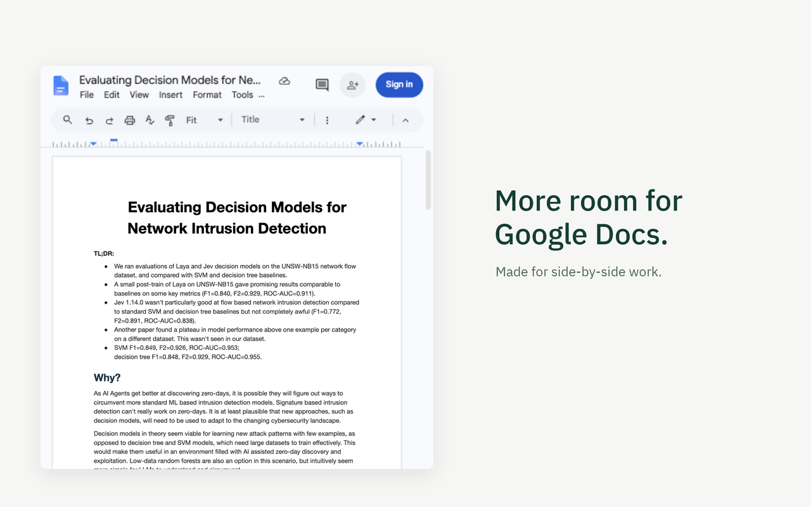

# CompactDocs

More room for Google Docs in a narrow window. Tile Docs beside your research or notes using your operating system's window controls. CompactDocs reclaims space inside the editor.

[Download the latest release](https://github.com/anguswww/compactdocs-chrome-extension/releases/latest) · [Website](https://anguswww.github.io/compactdocs-chrome-extension/) · [Privacy](https://anguswww.github.io/compactdocs-chrome-extension/privacy.html) · [Report a problem](https://github.com/anguswww/compactdocs-chrome-extension/issues)



## What it does

- Reclaims the document-tabs gutter and right Workspace rail.
- Reveals native panels when you hover along either window edge. The targets are invisible and span the full height of the window.
- Keeps panels over the document instead of moving the page. Move away to hide them, or use Tab, click, and Escape.
- Uses Google Docs' native Fit zoom in narrow windows for paged documents. Manual numeric zoom pauses automatic fitting. Pageless documents keep their native zoom.
- Saves three independent settings locally in your browser.

No analytics, network requests, runtime dependencies, or document-content collection. It adjusts the editing view, not your document text or page size.

## Install

1. Download `compactdocs-1.4.2.zip` from [Releases](https://github.com/anguswww/compactdocs-chrome-extension/releases/latest).
2. Extract the ZIP to a folder you can keep on your computer.
3. Open `chrome://extensions` and turn on **Developer mode**.
4. Select **Load unpacked** and choose the extracted folder.
5. Reload open Google Docs documents. Pin CompactDocs if you want quick access to its settings.

Install from the [Chrome Web Store](https://chromewebstore.google.com/detail/compactdocs/lilnjbpiikjfknobepdnlepjgalgdcfi) for automatic updates. The steps above are for manually loading a GitHub release. Store updates are submitted separately from GitHub releases.

## Use

Tile the browser beside another window. Hover at the left edge for document tabs and the outline, or at the right edge for the Google side panel where available. A short delay avoids accidental reveals. The tabs panel fades in and becomes more opaque as you enter it. Keyboard focus shows an outline around the otherwise invisible edge target.

In the toolbar popup, choose **Document tabs**, **Google side panel**, and **Fit page to window** independently. Disabling a panel option restores its native controls.

## Scope and limitations

Runs only on `https://docs.google.com/document/d/*`. Native-control detection currently targets English labels. Google Docs interface changes can affect compatibility. Workspace apps depend on the access provided by Google. Anonymous documents do not expose all signed-in features. The extension does not tile windows, force pageless text width, or provide a Chrome side-panel document viewer.

See [TESTING.md](TESTING.md) for historical checks and remaining manual cases. [Screenshot provenance](store/SCREENSHOTS.md) records the approved document captures, measured page gutters, and their verification limits.

## Develop

Use Node.js 24 or newer, plus the system `zip` and `unzip` commands. There are no npm dependencies to install.

```sh
npm test
npm run check
npm run package
```

After editing `compact.css`, run `npm run build` to refresh the bundled `styles.js`. The package command rebuilds styles, runs tests and syntax checks, and writes `dist/compactdocs-1.4.2.zip`. The ZIP contains only the extension runtime, icons, and MIT license, not tests, marketing assets, or website files.

## Releases and website

- CI checks pull requests and pushes to `main`.
- Pushing a matching version tag such as `v1.4.2` tests and packages the extension, then publishes a GitHub release with separate extension and store-asset ZIPs plus SHA-256 checksums.
- Website source lives in `site/`. The website workflow keeps `gh-pages` as the generated deployment branch. GitHub Pages deployment is enabled with the `PAGES_ENABLED` repository variable after Pages is configured.
- GitHub Pages must be available for the repository's visibility and account plan. A private repo on an unsupported plan cannot publish the site. The source and deployment branch remain ready.

See [CONTRIBUTING.md](CONTRIBUTING.md) for release and Pages setup instructions, and [store/LISTING.md](store/LISTING.md) for store submission fields.

## Support and license

[Open an issue](https://github.com/anguswww/compactdocs-chrome-extension/issues) or email [angus.wwww@gmail.com](mailto:angus.wwww@gmail.com). Do not include private document contents or credentials in reports.

[MIT](LICENSE), copyright 2026 Angus Wilson. Google Docs is a trademark of Google LLC. CompactDocs is independent of Google and is not affiliated with or endorsed by it.

Generate store artwork with `npm run assets:store` (requires uv and Pillow as pinned in the script). The outputs include `dist/compactdocs-1.4.2-store-assets.zip`. This is separate from the extension package: extract it and upload its four numbered PNGs in the store dashboard. See [upload instructions](store/UPLOAD.md).
